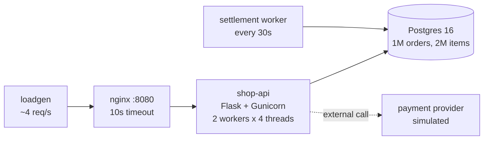

# prod-support-lab


A production support practice lab that runs on one laptop. It is a small online shop (Postgres with ~1M orders, a Python API behind Nginx, a settlement batch job and steady fake traffic) with **ten failure modes you can trigger on demand**, including a blind "mock incident" mode that only gives you a vague user ticket.

I built it to practise the part of support work that courses skip: working out what is actually wrong from logs, metrics and the database, under time pressure, and writing it up.



## Quick start

Needs Docker Desktop (4 GB RAM or more) and `make`.

```bash
make up         # first boot seeds the data, 2 to 4 minutes
make status     # one-screen health check
make logs       # follow nginx, app, worker and loadgen logs
make help       # everything else
```

Small machine or a 1 GB cloud VM? See [docs/EC2.md](docs/EC2.md).

## Break it

```bash
make chaos MODE=list           # see the failure modes
make chaos MODE=lock-hold      # practise one you know
make incident                  # hidden random failure + a user ticket
make reveal                    # what was it, and how long did you take
make reset                     # restore service (data damage stays: fixing it is part of the exercise)
```

| Mode | What the user reports | What it teaches |
|------|----------------------|-----------------|
| bad-release | Some customers fail at checkout | Correlating errors with a deploy, finding the affected segment |
| slow-upstream | Whole site slow | Timeouts, thread starvation, "504 but the order went through" |
| mem-leak | Intermittent Bad Gateway | Memory limits, OOM-killed workers, restart vs fix |
| conn-leak | Settlements stopped | `max_connections`, reserved slots, leaks that outlive the bug |
| lock-hold | Best sellers hang | Row locks, `idle in transaction`, blocker chains |
| runaway-query | Everything slower | CPU, parallel query, cancel vs terminate |
| disk-full | Finance export fails | `df` vs `du`, hidden files, ENOSPC |
| batch-fail | Settled more than we sold | Crash loops, non-idempotent jobs, duplicate data repair |
| db-down | Site down | Dependency failure and recovery |
| bad-config | Errors since config change | Liveness vs readiness, auth errors, rollback |

Plus one problem that is always there: a missing index on a 1M-row table.
Full details (with spoilers folded away): [docs/FAILURE_MODES.md](docs/FAILURE_MODES.md)

## Logs worth grepping

Every layer writes one `key=value` line per event, and a request ID follows each request from nginx into the app:

```
2026-10-19T09:54:41+00:00 req_id=c6cc5852... method=GET path="/customers/73365/orders" status=200 rt=0.039 urt=0.039 ...
2026-10-19T09:54:41.112Z level=INFO svc=shop-api version=1.4.1 req_id=c6cc5852... status=200 dur_ms=38.1 db_ms=36.9 msg="request complete"
```

Log files land in `logs/` on your machine, so `grep`, `awk`, `sort | uniq -c` all work directly.

## Repo layout

```
docker-compose.yml     the stack (plus Prometheus/Grafana under the "obs" profile)
db/init/               schema and seed scripts (run once, on an empty volume)
db/migrations/         changes made after seeding (indexes, constraints)
app/                   shop-api: Flask + Gunicorn, with the bugs behind chaos flags
worker/                settlement batch job
loadgen/               steady fake customer traffic
nginx/                 reverse proxy with a key=value access log
scripts/               chaos.sh, status.sh, smoke-test.sh
docs/                  failure modes, 6-week curriculum, day-one plan
incidents/             my incident write-ups
runbook/               my on-call notes, built up as I go
.github/workflows/     CI: lint, start the stack, smoke test incl. one chaos round trip
```

## Incident write-ups

| ID | Summary | Type |
|----|---------|------|
| _INC-001_ | _fill in_ | practice |


## Roadmap

Following [docs/CURRICULUM.md](docs/CURRICULUM.md): Postgres deep dive, app and HTTP layer, batch jobs and backups, porting to Kubernetes with kind, then Prometheus, Grafana, alerts and SLOs.
